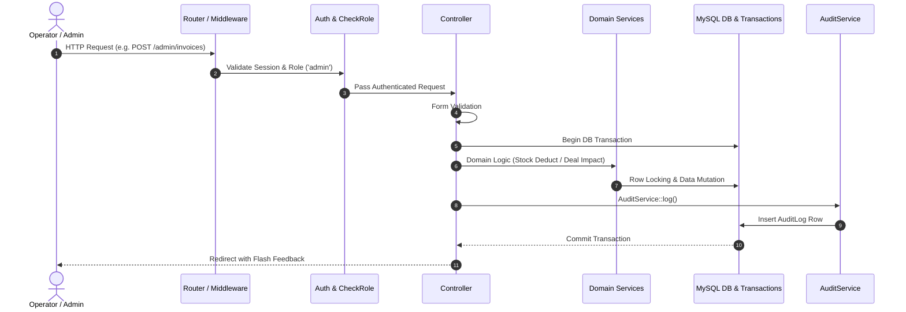

# Technical Architecture Assessment
**Application:** Pharmaceutical Company (SAAS)  
**Date:** October 2026  
**Auditor:** Principal ERP Architect  

---

## 1. Architectural Overview & Request Flow

The application follows a traditional Laravel monolithic MVC architecture:

---

## 2. Key Architecture Findings

### 2.1 Oversized Controllers with Mixed Concerns
- `InvoiceController` (726 lines) and `InvoiceReturnController` (985 lines) contain mixed responsibilities: HTTP request validation, DOM PDF rendering, CSV streaming, raw database transaction orchestration, stock calculation, doctor deal calculations, and presentation logic.
- **Remediation**: Extract domain logic into focused application services:
  - `InventoryService` for stock deductions, additions, transfers, and concurrency locking.
  - `DoctorCommissionService` for deal eligibility, progress calculations, and commission settlements.
  - `SecurityHelper` for CSV export sanitization.

### 2.2 Duplicated Business Logic & Inconsistent Calculations
- Doctor deal commission calculation is duplicated across:
  - `DoctorDealController::calculateDealStats`
  - `DoctorBalanceController::buildQuery`
  - `ReportController::showDoctor`
  - `ReportController::payDoctorCommission`
- Zone risk formula is duplicated between:
  - `DashboardController::index`
  - `ViewerDashboardController::index`
  - `ZoneReportController::calculateReportData`
  - `ViewerZoneReportController::calculateReportData`
- The duplicate implementations have diverged over time, leading to contradictory figures displayed on different screens.

### 2.3 Orphaned & Dead Scaffolding
- `app/Http/Controllers/Accountant/`: 6 controllers are 0 bytes (empty files).
- `routes/web.php:287`: `Route::middleware(['auth', 'role:accountant'])->...group(function () {});` is completely empty.
- `resources/views/accountant/`: 5 empty subdirectories and 2 zero-byte blade files.
- `app/Helpers/genral.php`: 0-byte file with a typographical name.
- **Recommendation**: Clean up or properly activate the accountant role workflow.

### 2.4 Audit Logging Durability Under Rollbacks
- Model audit logs generated inside database transactions are rolled back if the transaction fails.
- Critical security and authorization failures should be logged to durable channels (`storage/logs/laravel.log` or a separate connection) so that failed or malicious attempts are preserved even if database state is reverted.
