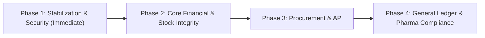

# Pharmaceutical Company (SAAS) — Strategic ERP Evolution Roadmap
**Target Architecture:** Full-Featured Pharmaceutical Distribution ERP  
**Planning Horizon:** 4 Quarters (Phases 1 to 4)  
**Date:** October 2026  

---

## 1. Roadmap Overview

The transformation of PharmaSys from a sales-and-return management tool into a comprehensive, compliant pharmaceutical ERP requires a disciplined, backward-compatible rollout.

---

## 2. Phase Breakdown

### Phase 1: Security Hardening & Concurrency Stabilization (Current Milestone)
**Goal:** Eliminate immediate production hazards, secure web assets, and prevent data corruption.
- Remove legacy unauthenticated PHP upload scripts in `public/assets/`.
- Disable public registration or gate account creation behind admin approval.
- Sanitize CSV formula injection on all reports and exports.
- Move state-mutating GET route `/admin/fix-deals` to a console command.
- Implement concurrency-safe return numbering and row-locking on warehouse stock.
- Fix baseline test failures (Auth and Example tests).

### Phase 2: Invoicing, Return & Financial Integrity (Current Milestone)
**Goal:** Safeguard historical records, unify business logic, and fix financial reporting.
- Restrict invoice editing/deletion when returns exist to protect return history.
- Prevent stock duplication when updating or deleting invoices.
- Unify doctor commission mathematics into a shared `DoctorCommissionService`.
- Synchronize zone expenses when settling doctor deals from all screens.
- Correct the dashboard SQL join bug that multiplies discounts across line items.
- Ensure all data exports are logged in the audit trail.
- Introduce regression and feature test suites.

### Phase 3: Procurement & Supplier Management (AP) (Target: Next Quarter)
**Goal:** Close the largest operational ERP gap by adding a traceable procurement cycle.
- **Supplier Master Data**: Supplier profile, contact, payment terms, tax ID.
- **Purchase Orders (PO)**: Draft, approved, sent, received, closed statuses.
- **Goods Receipt Notes (GRN)**: Record incoming stock by warehouse, linking stock additions directly to verified purchases instead of arbitrary manual adjustments.
- **Supplier Invoices & Payables**: 3-way matching (PO vs. GRN vs. Invoice), payment schedules, accounts payable aging, and purchase returns.

### Phase 4: Pharmaceutical Traceability & General Ledger (Target: Quarters 3 & 4)
**Goal:** Meet regulatory pharmaceutical standards and formal accounting requirements.
- **Batch / Lot & Expiry Management**:
  - Add `batch_number`, `manufacture_date`, and `expiry_date` to inventory tracking.
  - Enforce First-Expiry, First-Out (FEFO) automated allocation on sales invoices.
  - Implement quarantine status for expired or recalled batches.
  - Drug recall traceability report (tracking from supplier batch to customer invoices).
- **Immutable Stock Movement Ledger**:
  - Implement `stock_movements` table recording every single quantity change with movement type (Sale, Return, Purchase, Transfer, Adjustment), reference ID, user, and timestamps.
- **Double-Entry General Ledger (GL)**:
  - Chart of Accounts (Assets, Liabilities, Equity, Revenue, Cost of Goods Sold, Operating Expenses).
  - Automated journal entries generated upon:
    - Sales Invoice posting (Debit AR / Credit Sales & Inventory / Debit COGS).
    - Customer Collection (Debit Cash/Bank / Credit AR).
    - Sales Return (Debit Sales Returns & Credit AR / Debit Inventory & Credit COGS).
    - Purchase Invoice (Debit Inventory / Credit AP).
    - Supplier Payment (Debit AP / Credit Cash/Bank).
  - Trial Balance, Balance Sheet, and Income Statement (P&L).

### Phase 5: Multi-Tenant SaaS Isolation (Long-Term Architectural Initiative)
- If multi-tenant SaaS operation is officially required:
  - Add `companies` / `tenants` table.
  - Add `company_id` foreign keys and composite indexes to all operational tables.
  - Implement a tenant-scoping trait (`BelongsToTenant`) and middleware for request resolution.
  - Provide database migration and backfill scripts for existing operational data.
